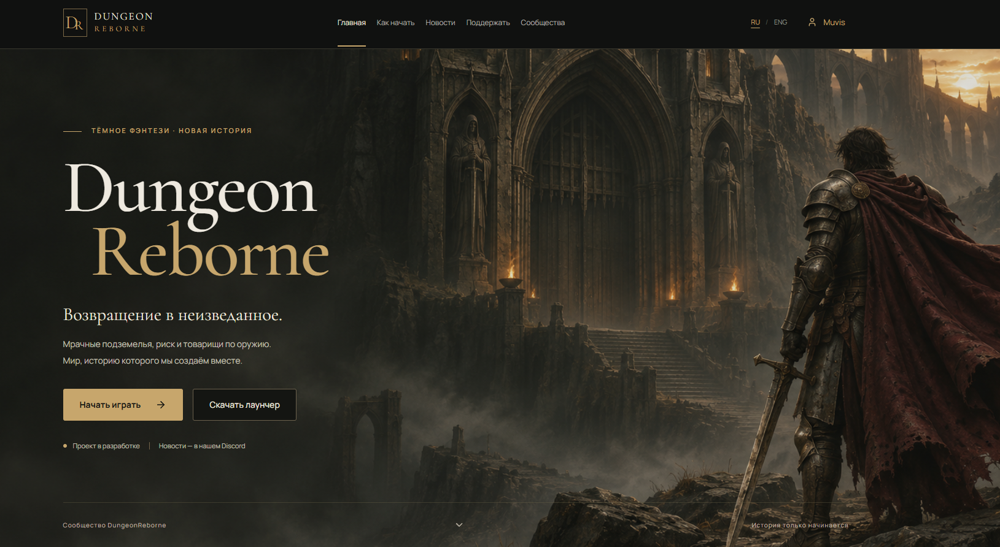
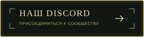
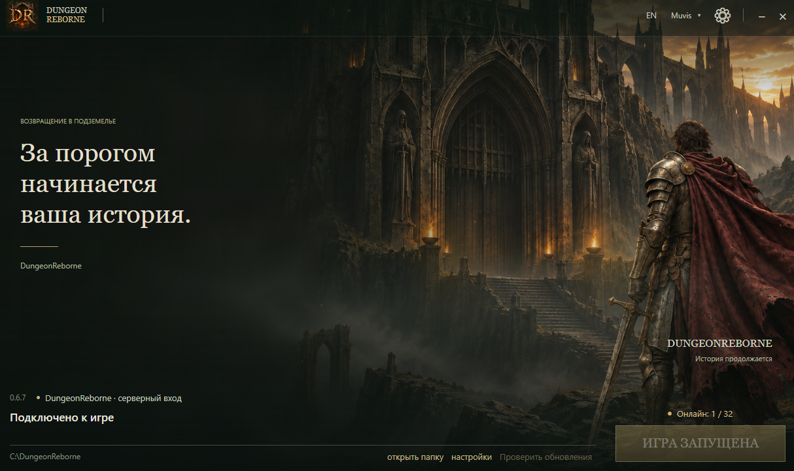

# ⚔️ DungeonReborne — проект для сообщества Dungeonborne

**Мрачные подземелья · PvPvE · Сообщество RU / ENG**

**DungeonReborne** — независимый проект для игроков **Dungeonborne**, которым близки мрачное фэнтези, исследование подземелий, опасные рейды и борьба за добычу. Мы развиваем инфраструктуру проекта: сайт, собственный лаунчер, систему аккаунтов и игровые серверы.

Если вы ищете **Dungeonborne сервер**, интересуетесь развитием сообщества Dungeonborne или хотите следить за DungeonReborne, начните с нашего сайта: **[dungeonreborne.com](https://dungeonreborne.com)**.

> Проект находится в разработке. Готовимся к запуску — следите за новостями на сайте и в нашем Discord.

  
  

---

## 🛡️ Что такое DungeonReborne

DungeonReborne объединяет работу над игровой инфраструктурой и сообщество поклонников Dungeonborne. Наша цель — подготовить удобный путь от регистрации до запуска игры: создать аккаунт на сайте, открыть лаунчер, загрузить необходимые файлы и подключиться к доступному серверу.

Нам интересен тот опыт, за который игроки ценят Dungeonborne: напряжённые PvPvE-сражения, взаимодействие классов, поиск снаряжения и решение, когда продолжать рейд, а когда пора эвакуироваться с добычей.

Мы делаем DungeonReborne постепенно и хотим обсуждать развитие проекта с игроками: от удобства лаунчера до игровых механик и баланса.

---

## 🌐 Сайт, регистрация и личный кабинет

На **[сайте DungeonReborne](https://dungeonreborne.com)** развивается система регистрации, входа и личного кабинета. Аккаунт сайта используется для авторизации в нашем лаунчере; работа над связью с игровым профилем и проверкой полного игрового цикла продолжается.

Для нас важно, чтобы игроку не приходилось разбираться в ручной настройке файлов перед каждым запуском. Сайт и лаунчер DungeonReborne должны стать понятной точкой входа в проект для сообщества Dungeonborne.

---

## 🖥️ Собственный лаунчер DungeonReborne для Windows

Для проекта написан собственный интерфейс лаунчера на C#. Его задачи — авторизация через сайт, загрузка клиента, проверка файлов, получение обновлений и запуск игры.

При первом запуске лаунчер показывает свой интерфейс и автоматически подготавливает служебные файлы в AppData. Для этого не нужно проходить мастер установки или выбирать системную папку. Загрузка самой игры запускается отдельно кнопкой **«Установить»**.

Лаунчер находится в активной разработке. Совместимость, обновления и сценарии установки продолжают проверяться; сообщения об ошибках помогают нам улучшать его перед более широким тестированием.

---

## 🏰 Игровые серверы и тестирование Dungeonborne

Одно из основных направлений DungeonReborne — подготовка серверной инфраструктуры и проверка подключения игроков. Перед публичным открытием необходимо проверить совместный рейд с разных компьютеров, эвакуацию и сохранение инвентаря после повторного входа.

Готовимся к запуску DungeonReborne. Информацию о доступных серверах, условиях подключения и развитии проекта публикуем на сайте и в нашем Discord.

Если вы ищете, **где играть в Dungeonborne**, следите за нашими анонсами. Именно в них появятся подтверждённые сведения о публичном тесте, доступности серверов и необходимых версиях клиента.

---

## 💬 Сообщество DungeonReborne: RU и ENG

В [Discord проекта](https://discord.gg/J9rmpSzBkf) подготовлены русскоязычный и англоязычный разделы сообщества. В них есть общий чат, новости, отчёты о разработке, идеи и предложения, обсуждение баланса, форум багов и канал знакомства с новыми участниками.

Обсуждения идей разделены по темам:

- Классы — Classes.
- Оружие — Weapons.
- Мобы — Mobs.
- Боссы — Bosses.
- Экономика — Economy.
- Механики — Mechanics.
- Другое — Other.

Мы приглашаем игроков Dungeonborne делиться конкретными предложениями и наблюдениями. Для сообщения об ошибке полезно указать версию игры или лаунчера, шаги воспроизведения, ожидаемый результат и приложить скриншот либо видео.

---

## 🧭 Что дальше

Ближайшая работа связана с надёжностью установки и обновления клиента, системой аккаунтов, серверной инфраструктурой и проверкой сохранения игрового прогресса. Параллельно будем развивать сайт, публиковать новости DungeonReborne и собирать обратную связь сообщества Dungeonborne.

Новости запуска, условия подключения и дополнительные возможности проекта — на сайте и в нашем Discord.

---

## ❓ Частые вопросы о DungeonReborne и Dungeonborne

### DungeonReborne — это официальный Dungeonborne?

Нет. DungeonReborne — независимый проект сообщества. Мы не заявляем об официальном статусе или связи с правообладателями Dungeonborne. Упоминания Dungeonborne используются для описания игры и аудитории проекта.

### Как начать играть в DungeonReborne?

Откройте **[dungeonreborne.com](https://dungeonreborne.com)**, ознакомьтесь с актуальными анонсами, ознакомьтесь с инструкцией по началу игры и системой аккаунтов. Возможность подключения к игре зависит от текущего этапа тестирования и доступности серверов.

### Где следить за новостями DungeonReborne?

Новости разработки и анонсы публикуются на [сайте проекта](https://dungeonreborne.com) и в [нашем Discord](https://discord.gg/J9rmpSzBkf).

### Где следить за запуском DungeonReborne?

Мы готовимся к запуску. Следите за сайтом и нашим Discord — там появятся новости открытия и инструкции по подключению.

### Можно ли предложить изменения для Dungeonborne в рамках проекта?

Да. В сообществе DungeonReborne есть отдельные форумы для идей, игровых механик и предложений по балансу. Предложения рассматриваются в контексте возможностей и текущего этапа проекта.

---

## 🌍 DungeonReborne — for the Dungeonborne community

DungeonReborne is an independent community project for Dungeonborne players. We are developing a website, account system, a custom Windows launcher, and game server infrastructure.

The project is under active development and we are preparing for launch. Follow **[DungeonReborne](https://dungeonreborne.com)** and our Discord for launch news, connection instructions, and launcher updates.

**Официальный сайт проекта DungeonReborne: [dungeonreborne.com](https://dungeonreborne.com).**

---

**Присоединяйтесь к DungeonReborne**

  
  

